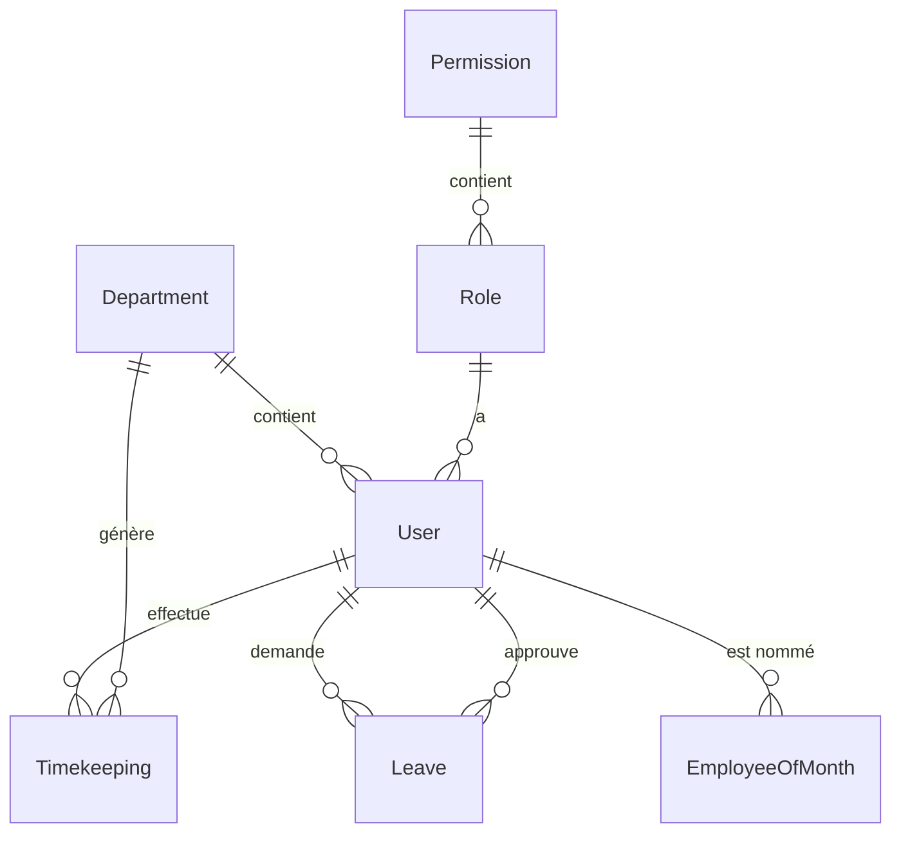

# Architecture RH Platform

## Vue d'ensemble

RH Platform est une application web moderne construite avec Flask, offrant une solution complète de gestion des ressources humaines avec pointage, gestion des congés, analyse des performances et calcul des coûts salariaux.

## Architecture Technique

### Stack Technologique

```
Frontend:
├── HTML5 + CSS3
├── Bootstrap 5 (UI Framework)
├── JavaScript ES6+
├── Chart.js (Graphiques)
└── Jinja2 (Templates)

Backend:
├── Python 3.11+
├── Flask (Framework Web)
├── SQLAlchemy (ORM)
├── Alembic (Migrations)
├── JWT (Authentification)
└── PostgreSQL (Base de données)

Infrastructure:
├── Docker (Conteneurisation)
├── Docker Compose (Orchestration)
├── Nginx (Reverse Proxy)
├── Redis (Cache/Sessions)
└── GitHub Actions (CI/CD)
```

### Architecture Modulaire

```
rh-platform/
├── app/                    # Application principale
│   ├── __init__.py        # Configuration Flask
│   ├── models/            # Modèles de données
│   │   ├── user.py        # Utilisateurs et rôles
│   │   ├── department.py  # Départements
│   │   ├── timekeeping.py # Pointages
│   │   ├── leave.py       # Congés
│   │   └── employee_of_month.py
│   ├── routes/            # Contrôleurs API
│   │   ├── auth.py        # Authentification
│   │   ├── timekeeping.py # Pointages
│   │   ├── leaves.py      # Congés
│   │   ├── dashboard.py   # Tableau de bord
│   │   └── web.py         # Routes web
│   ├── services/          # Logique métier
│   │   ├── auth_service.py
│   │   ├── timekeeping_service.py
│   │   └── dashboard_service.py
│   ├── schemas/           # Validation des données
│   ├── templates/         # Templates HTML
│   └── static/            # Assets (CSS, JS)
├── migrations/            # Migrations Alembic
├── tests/                 # Tests unitaires
├── docs/                  # Documentation
└── config.py             # Configuration
```

## Modèles de Données

### Entités Principales

1. **User** - Utilisateurs du système
   - Informations personnelles et professionnelles
   - Rôles et permissions (RBAC)
   - Relations avec les départements

2. **Department** - Départements de l'entreprise
   - Gestion des budgets et coûts
   - Statistiques par département
   - Relations avec les utilisateurs

3. **Timekeeping** - Pointages des employés
   - Arrivée/départ
   - Calcul automatique des retards
   - Heures supplémentaires
   - Validation par les managers

4. **Leave** - Gestion des congés
   - Types de congés (annuels, maladie, etc.)
   - Workflow de validation
   - Calcul des soldes

5. **EmployeeOfMonth** - Employé du mois
   - Critères de sélection personnalisables
   - Scores de performance
   - Historique des nominations

### Relations entre Entités



## API REST

### Structure des Endpoints

```
/api/auth/
├── POST /login           # Connexion
├── POST /register        # Inscription
├── POST /refresh         # Rafraîchir token
├── POST /logout          # Déconnexion
└── GET  /me             # Profil utilisateur

/api/timekeeping/
├── POST /punch          # Effectuer un pointage
├── GET  /today          # Pointages du jour
├── GET  /user/{id}      # Historique utilisateur
├── GET  /summary/{id}   # Résumé mensuel
└── GET  /overtime       # Rapport heures sup

/api/leaves/
├── POST /               # Demander un congé
├── GET  /               # Liste des congés
├── POST /{id}/approve   # Approuver un congé
└── POST /{id}/reject    # Rejeter un congé

/api/dashboard/
├── GET /stats           # Statistiques globales
├── GET /departments     # Stats par département
└── GET /reports         # Rapports détaillés

/api/employee-of-month/
├── GET  /current        # Employé du mois actuel
├── GET  /history        # Historique
└── POST /               # Nommer un employé
```

### Authentification JWT

- **Access Token** : 8 heures de validité
- **Refresh Token** : 30 jours de validité
- **Claims** : user_id, email, role, permissions
- **Sécurité** : HTTPS obligatoire en production

## Sécurité

### Authentification et Autorisation

1. **JWT Tokens** : Authentification stateless
2. **RBAC** : Gestion des rôles et permissions
3. **Validation** : Schémas Marshmallow
4. **Rate Limiting** : Protection contre les abus
5. **CORS** : Configuration pour les clients web

### Bonnes Pratiques OWASP

- Validation des entrées
- Protection CSRF
- Headers de sécurité
- Logging des actions sensibles
- Chiffrement des mots de passe (bcrypt)

## Performance

### Optimisations

1. **Base de données**
   - Index sur les colonnes fréquemment utilisées
   - Requêtes optimisées avec SQLAlchemy
   - Pagination pour les grandes listes

2. **Cache**
   - Redis pour les sessions
   - Cache des statistiques fréquentes
   - Mise en cache des graphiques

3. **Frontend**
   - Assets minifiés
   - Lazy loading des composants
   - Mise à jour en temps réel (AJAX)

## Monitoring et Logging

### Logs Structurés

- **Format** : JSON structuré
- **Niveaux** : DEBUG, INFO, WARNING, ERROR
- **Contexte** : user_id, action, timestamp
- **Rotation** : Logs quotidiens

### Métriques

- Temps de réponse des API
- Taux d'erreur
- Utilisation des ressources
- Nombre d'utilisateurs actifs

## Déploiement

### Environnements

1. **Développement**
   - Base de données locale
   - Mode debug activé
   - Logs détaillés

2. **Staging**
   - Environnement de test
   - Données de test
   - Tests automatisés

3. **Production**
   - Base de données dédiée
   - SSL/TLS obligatoire
   - Monitoring complet

### CI/CD Pipeline

```yaml
GitHub Actions:
├── Tests unitaires
├── Tests d'intégration
├── Analyse de sécurité
├── Build Docker
└── Déploiement automatique
```

## Scalabilité

### Architecture Horizontale

- **Load Balancer** : Distribution de charge
- **Base de données** : Réplication master/slave
- **Cache** : Cluster Redis
- **Statiques** : CDN

### Microservices (Future)

- Service d'authentification
- Service de pointage
- Service de gestion des congés
- Service de reporting
- Service de notifications

## Maintenance

### Sauvegarde

- **Base de données** : Sauvegarde quotidienne
- **Fichiers** : Sauvegarde hebdomadaire
- **Configuration** : Versioning Git

### Mises à jour

- **Sécurité** : Patches automatiques
- **Fonctionnalités** : Releases planifiées
- **Base de données** : Migrations Alembic

## Conclusion

Cette architecture offre une base solide et évolutive pour la plateforme RH, avec une séparation claire des responsabilités, une sécurité renforcée et une facilité de maintenance et d'évolution.